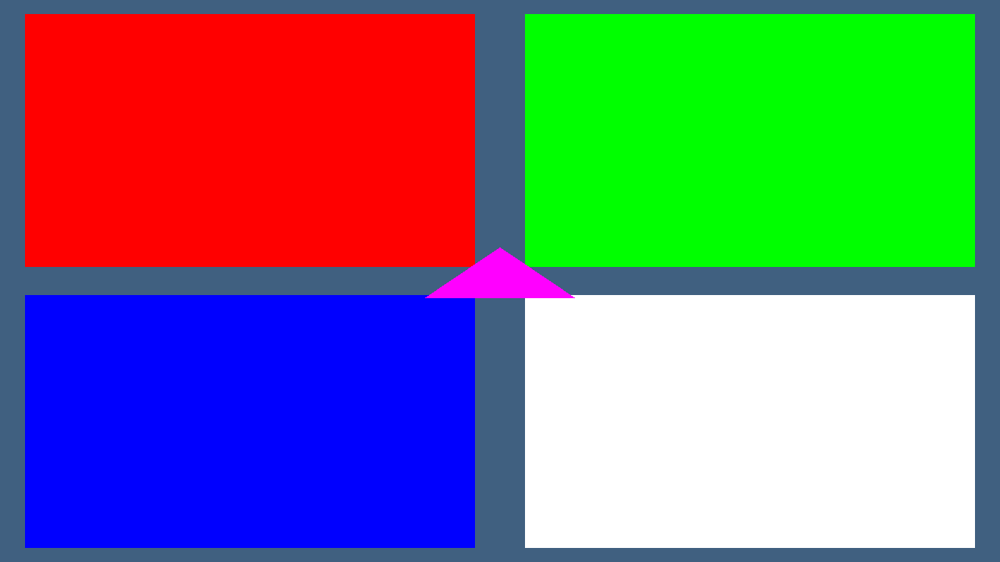

# The WebGPU RSX backend (Emscripten)

`libs/video/rsx_webgpu_backend.c` implements eight slots of the `rsx_backend`
vtable for the browser, compiled only under `__EMSCRIPTEN__`. This note records what
it does, the mapping it chose, how to prove it works, and -- the part worth reading
-- what WebGPU genuinely cannot express that the RSX needs.

## Scope: eight slots, and that is a complete backend

Implemented: `init`, `shutdown`, `set_render_target`, `set_vertex_attribs`,
`clear`, `bind_texture`, `draw_arrays`, `draw_indexed`, `present`.

Deliberately null: the other thirty-four. Every call site in `rsx_commands.c`
already null-checks the slot it calls, so a null is "tracked in `rsx_state`, not
acted on", not a crash. This is the same bargain `rsx_null_backend.c`'s software
path makes.

The omitted slots fall into one group, and naming the group is more useful than
listing them: **they all need guest shaders, or runtime pipeline state.**
`set_blend`, `set_depth_stencil`, `set_alpha_test`, `set_shader`, `set_color_mask`
and `set_viewport` each change state that WebGPU bakes into an immutable pipeline
object. Honouring them at runtime means keeping a pipeline cache keyed on (blend,
depth, cull, colour mask, topology) and rebuilding when any of them changes.
`set_shader` is worse: the RSX's programs are NV40 microcode, and there is no
NV40-to-WGSL translator in this tree (`rsx_shader_spirv.cpp` and
`rsx_shader_msl.cpp` lower HLSL to SPIR-V and MSL respectively; neither waypoint is
WGSL).

## The Vulkan to WebGPU mapping

`rsx_vulkan_backend.c` is 4086 lines over 92 entry points. This file is ~1750, and
most of the difference is ceremony WebGPU does not have.

**Render pass / framebuffer -> nothing persistent.** A pass is begun inside the
command encoder and its attachments are given as views for that pass only
(`wgpuCommandEncoderBeginRenderPass`). There is no compatibility question, so the
render-pass cache and the "which PSO is compatible with this pass" bookkeeping have
no counterpart. The clear is a `loadOp = Clear` on the first pass of a frame --
WebGPU has no standalone clear command, and a load op is cheaper than a full-screen
quad.

**Descriptor set + layout -> bind group + layout.** No pool, no per-descriptor
allocation or free, no memory types. A bind group is created against a layout and is
then immutable, which is why binding a texture means *rebuilding the group* rather
than writing a slot.

**vkCmdPipelineBarrier with explicit layouts -> nothing.** This is the largest
single deletion. WebGPU derives a texture's usage from the pass or copy it appears
in and inserts whatever transition is needed. There is no image layout in the API at
all, so the entire barrier/layout half of the Vulkan backend does not exist here.

**vkAllocateMemory / vkBindBufferMemory -> nothing.** A buffer or texture owns its
storage from creation. No heap selection, no memory-type scoring function, no
staging ring. Uploads are `wgpuQueueWriteBuffer` / `wgpuQueueWriteTexture`, copying
from CPU memory.

**Swapchain -> canvas configuration.** `wgpuSurfaceConfigure` once, then
`wgpuSurfaceGetCurrentTexture` per frame. The browser owns the image count and the
presentation engine: no acquire semaphore, no present queue, no `vkQueuePresentKHR`.
`wgpuSurfacePresent` is explicitly unimplemented in emdawnwebgpu ("use
requestAnimationFrame via html5.h instead") because a canvas is composited when the
frame ends, not when a command is submitted. So `present` here is: end the encoder,
submit, release the view, let the compositor run.

**vkCmdCopyImageToBuffer readback -> `wgpuCommandEncoderCopyTextureToBuffer` +
`wgpuBufferMapAsync`.** Same two steps, no layout transition first. This backend
does not currently read anything back; the path is named because a probe that wants
to assert on a pixel without a browser screenshot would need it.

## The Emscripten idiom, and the one hard constraint

`emdawnwebgpu` is the only supported WebGPU binding under Emscripten 6.0.11.
`-sUSE_WEBGPU=1` is rejected by the port itself ("emdawnwebgpu may not be used with
-sUSE_WEBGPU=1"), so `--use-port=emdawnwebgpu` is the spelling that applies. The
port also requires a C++ link; a plain C link aborts with "emdawnwebgpu requires
C++. Link using em++ (or emcc -sDEFAULT_TO_CXX)". `CMakeLists.txt` passes
`-sDEFAULT_TO_CXX`, which leaves this file as plain C.

**The hard constraint is that adapter and device acquisition are asynchronous.**
There are two obvious ways to wait for them and both are wrong here:

- `-sASYNCIFY` and `-sJSPI` suspend the wasm stack. A vtable slot whose C signature
  is "void, returns now" cannot suspend unless the linker was told to rewrite the
  whole program around that, and the callers here -- `rsx_commands.c`, the FIFO
  consumer, the PPU thread -- are not written for it. That is a change to the
  emulator, not to a backend.
- Spinning on `wgpuInstanceProcessEvents` inside wasm never completes: the callback
  needs a browser task to run, and a wasm loop does not yield one.

So the backend is **callback-driven and pumped from `requestAnimationFrame`**:

1. `rsx_webgpu_backend_init` creates the instance and requests an adapter with
   `WGPUCallbackMode_AllowProcessEvents`, then returns.
2. The host calls `rsx_webgpu_backend_pump()` once per rAF. That calls
   `wgpuInstanceProcessEvents`, requests the device when the adapter arrives, and
   finishes bring-up (surface, swapchain, pipelines) when the device arrives.
3. Until then `is_ready()` is 0 and every slot early-returns.

A page may instead hand the device in through `Module.preinitializedWebGPUDevice`
after awaiting it itself; that is the mechanism emdawnwebgpu's
`emscripten_webgpu_get_device()` reads. It is **not** used by this backend because
that helper is not wasm64-safe: its generated JS returns
`BigInt(preinitializedDeviceId)` from a wrapper that receives `0`, which throws
`TypeError: Cannot convert 0 to a BigInt` before any call reaches wasm. The callback
path above avoids it entirely and works under wasm64.

## What WebGPU genuinely cannot express that the RSX needs

This is the most valuable section, so it is specific.

**1. Rendering to the guest's own VRAM surfaces.** The RSX renders into 32-bit
offsets in guest local memory, and a title routinely renders to an offscreen shadow
or G-buffer and then samples it as a texture in the same frame. A browser canvas is
a single `GPUTexture` you do not own: `wgpuSurfaceGetCurrentTexture` hands you one
image and the compositor takes it back. To emulate a guest render target you must
allocate your own `GPUTexture` mirroring the guest surface and blit it to the canvas
at present. That is entirely doable, but it is a *second* render path, and it is the
single largest piece of work this backend has not done. It is why
`set_render_target` only caches the state pointer.

**2. Depth and stencil, as the guest configures them.** The RSX has a Z24S8 depth
buffer at a guest offset with its own function, write mask and two-sided stencil.
WebGPU has depth-stencil attachments, so the *feature* exists -- but a `WGPUTexture`
must be created with a fixed format and reused; there is no "depth buffer at guest
offset X". Emulation means owning a depth texture per guest surface and copying it,
and `Depth24Plus` is a *format without a defined bit layout*: WebGPU deliberately
declines to say what `depth24plus` is made of, so there is no correct way to read it
back into the guest's Z24S8. A title that samples its own depth buffer (shadow maps,
soft particles, depth-based fog) cannot be served by `depth24plus` at all;
`Depth32Float` is the only readable choice and it is not the guest's format.

**3. The NV40 vertex program and fragment program.** WebGPU's only shader language
is WGSL. There is no SPIR-V ingestion (that is an optional Dawn extension and
emdawnwebgpu does not expose it in the browser), and no HLSL. So the guest's
microcode has to become WGSL. The two existing decompilers emit HLSL; an
HLSL-to-WGSL step does not exist in this tree, and writing one is a compiler
project, not a backend task. `set_shader` is null for this reason.

**4. Runtime pipeline state.** The RSX is a fixed-function-plus-shader pipeline
where blend, depth, cull, colour mask and alpha test are registers the guest writes
between draws -- often every draw. In WebGPU every one of those is baked into an
immutable `WGPURenderPipeline`. A faithful backend therefore needs a pipeline cache
keyed on the full state tuple. That is tractable (dozens of entries for a real
title) but it is a real component, and its absence is why blending, depth test and
culling are all off rather than "approximated".

**5. Multi-render-target and surface formats.** The RSX supports MRT (up to four
colour targets) and formats like B8, R5G6B5, DXT-compressed. WebGPU supports MRT,
but a compressed guest texture can only be bound if the `GPUTexture` is created with
the matching BC format, which requires the `texture-compression-bc` feature to be
requested and available -- not guaranteed in a browser. This backend decodes to RGBA8
instead and leaves compressed guest textures unbindable rather than guessing.

**6. Mapping guest memory as a GPU resource.** WebGPU cannot import a
`WebAssembly.Memory` buffer as a vertex or storage buffer. Every vertex, index and
texture byte must be copied through `wgpuQueueWriteBuffer` /
`wgpuQueueWriteTexture`. On the RSX the GPU reads guest memory directly; here every
draw pays a CPU fetch (`rsx_fetch_attrib`) plus a copy. That is the defining
performance cost of this backend, it cannot be engineered away within WebGPU, and it
is why the CPU fetch was chosen over trying to fake a mapping.

**7. Occlusion queries and conditional rendering.** WebGPU has occlusion queries but
no conditional render gated on a query without a GPU-side round trip; the RSX's
report/conditional paths cannot be expressed as a GPU-side predicate.

## Proving it

`tools/test_rsx_webgpu_backend.py` is the acceptance test, registered with CTest as
`rsx_webgpu_backend`.

Its native half always runs: it links the backend for the host, where every symbol
is inert, and asserts the contract (`init` returns -1, `pump` returns -1,
`is_ready` is 0, accessors are 0). That makes "the new file costs the native build
nothing" a checked claim.

Its browser half builds the same C for **wasm64** through `--use-port=emdawnwebgpu`,
drives the real RSX method dispatch into the real backend, and reads the canvas
backing store with `toDataURL`. It asserts the clear colour the guest asked for and
all four quadrants plus the centre triangle -- so a channel swap, a missing present,
or a frame that showed only its last draw all fail.

Headless Chromium on this machine needs four flags, and **three of them are not
optional**:

    --enable-unsafe-webgpu --use-angle=swiftshader \
    --enable-features=Vulkan --use-vulkan=swiftshader

`--use-angle=swiftshader` alone yields `requestAdapter() -> null`. It was measured,
not guessed. `tools/run_canvas_blit_probe.js` now takes extra Chromium flags after
its `[chrome]` argument and drops its `--disable-gpu` when any are given, so the CPU
blit probe keeps exactly the command line it had.

Run it:

    source <emsdk>/emsdk_env.sh
    python3 tools/test_rsx_webgpu_backend.py --screenshot /tmp/wgshots

## Evidence

The screenshot above is the canvas at its native 1280x720, captured from
toDataURL after one frame -- so it is the pixels the render pass wrote, not a
CSS-scaled compositor grab.

Decoded from `webgpu-probe-native.png` (the canvas at its native 1280x720, via
`toDataURL`, so these are the pixels the render pass wrote):

| region | pixel | expected | result |
|---|---|---|---|
| clear corner (5,5) | (64, 96, 128, 255) | 0x20406080 -> RGB(64,96,128) | PASS |
| top-left quadrant | (255, 0, 0, 255) | red | PASS |
| top-right quadrant | (0, 255, 0, 255) | green | PASS |
| bottom-left quadrant | (0, 0, 255, 255) | blue | PASS |
| bottom-right quadrant | (255, 255, 255, 255) | white | PASS |
| centre triangle | (255, 0, 255, 255) | magenta | PASS |
| clear, bottom edge | (64, 96, 128, 255) | 0x20406080 | PASS |

Adapter: `google|swiftshader` (SwiftShader, as expected with no GPU). Surface format
22 = `rgba8unorm`. One submit per frame.

## Two bugs this found, and what they say

The first working build cleared correctly and showed the *last* draw only -- the four
quadrants read as the clear colour. The cause is specific to a submit-at-end-of-frame
API: every draw wrote its vertices to offset 0 of one shared vertex buffer, and a
command buffer executes at `wgpuQueueSubmit` time, so all five draws read whichever
vertices had been uploaded last. The fix is a per-frame upload arena with distinct
offsets per draw, plus a mid-frame flush when the arena runs out (a frame may submit
more than once; the canvas is still composited once). This is exactly the class of
bug that a "it compiles and the clear is right" check would miss, which is why the
probe asserts the drawn regions and not only the clear.

The second was a load-op ordering error with the same signature. The draw path
chose its load op from whether a swapchain image had been *acquired*, which happens
on the first thing that touches the frame -- so a frame whose first event was a draw
would begin its pass with Load and paint onto an undefined attachment. The fix is an
explicit per-frame pass counter: the frame's first pass clears, every later one
loads, and a colour clear arriving while a pass is already open ends it first (a
load op belongs to beginning a pass, so extending an open pass cannot retroactively
clear it). A title that draws, clears, then draws again is exactly this case.

## Build flags, and whether they are inert on native

Both `--use-port=emdawnwebgpu` and `-sDEFAULT_TO_CXX` are added inside
`if(EMSCRIPTEN)` in `CMakeLists.txt`, targeting `ps3recomp_runtime`. On a native
configure the block does not execute, so gcc never sees either flag; and because the
whole implementation in `rsx_webgpu_backend.c` is inside `#ifdef __EMSCRIPTEN__`,
the translation unit is empty there. Verified: a native build compiles
`rsx_webgpu_backend.c` to object 113 of 173 with no warnings, and
`./build/ps3recomp_boot_smoke build/smoke/smoke.elf` still prints `[smoke] PASS`.

`-sDEFAULT_TO_CXX` is required, not cosmetic: without it the link fails with
"emdawnwebgpu requires C++. Link using em++ (or emcc -sDEFAULT_TO_CXX), instead of
emcc."
